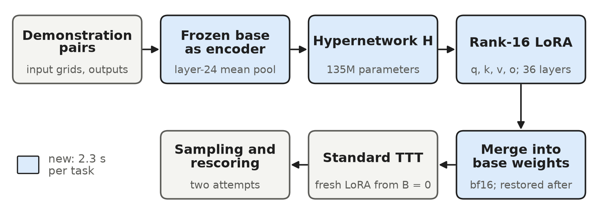

# ARC-AGI-2: test-time training, LLM program synthesis, and a hypernetwork that writes LoRA adapters

An entry to [ARC Prize 2026](https://www.kaggle.com/competitions/arc-prize-2026-arc-agi-2) on Kaggle
(September to November 2026). Each submission solves the hidden ARC-AGI-2 test set offline
within 12 hours on 4 x L4 GPUs. This repository holds four pieces of work:

1. **Test-time training (TTT) solver.** The 2025 first-place NVARC notebook, moved into the
   `arc26` package without changing its behavior, then tuned.
2. **H-net.** A 135M-parameter hypernetwork that maps a task's demonstration pairs to a rank-16
   LoRA adapter in one forward pass.
3. **LLM program synthesis.** A reasoning model that writes Python while it thinks; programs run
   in a sandbox and count only if they reproduce every demonstration.
4. **A 4-bit KV cache for SGLang**, with custom Triton kernels. It fits 1.41x more tokens on each
   L4, so the LLM solver serves more concurrent streams.

## Results

Public leaderboard scores of this project's Kaggle submissions. The public leaderboard scores a
subset of the hidden test set; differences under 2 points are noise.

| Build | What it runs | Public score |
|---|---|---:|
| P5.8-03 | LLM program synthesis, 4-bit KV cache, six streams, JSON-schema forced answers | **32.92** [^late] |
| NVARC reference | The 2025 winner's notebook, run unchanged (calibration) | 30.97 |
| Version 6 | TTT (rank-16 LoRA) plus a 27B LLM answering the least-confident tasks directly | 30.28 |
| Version 2 | NVARC moved into `arc26` without behavior change | 29.72 |
| Version 9 | Version 8 plus a rank-256 TTT pass on the tasks rank 16 left at confidence 0 | 29.44 [^final] |
| Version 4 | TTT plus the first version of the 27B direct-answer stage | 28.61 |
| Version 3 | TTT at rank 16 on q, k, v, o (no LLM) | 28.47 |
| Version 18 | LLM program synthesis with the 4-bit KV cache, five streams | 27.64 |
| Version 13 | LLM program synthesis, FP8 KV cache, three streams | 17.50 |
| Version 10 | 27B LLM answering every task directly, no TTT | 13.19 |
| Version 19 | H-net merged into the base, then NVARC's rank-256 TTT | not recorded [^late] |

[^late]: Submitted on the last day; it finished scoring after the final selection had locked.
[^final]: The selected final entry.

The full development ledger, with subsets, task counts and seeds, is [`RESULTS.md`](RESULTS.md).
DEV40 and DEV120 are 40 and 120 tasks of the public evaluation set (one DEV40 task is 2.5 points);
DEV120 is optimistic for the base model, whose fine-tuning data was generated from summaries of
all 120 public evaluation tasks.

## 1. Test-time training solver

`arc26/nvarc/` holds the NVARC notebook's cells as modules, generated by
`scripts/extract_reference.py` from [`reference/reference_notebook.ipynb`](reference/) (Apache
2.0). A parity fixture of the untouched notebook's outputs (`tests/fixtures/`) guards every change
to tokenization, augmentation and decoding. On top of it:

- `arc26/solver.py` splits training and decoding into separately timed stages, and every GPU
  operation writes a timing record (`arc26/timing.py`, `reports/P1.1-01/`).
- LoRA scope: rank 16 on q, k, v, o solved 10.5 of 40 DEV40 tasks against 8.5 for NVARC's rank
  256 on all projections, in less time per task ([P1.3-01](docs/experiments/P1.3-01.md)).
- A held-out-pair refinement loop (`arc26/loop.py`, `arc26/governor.py`) was built and measured;
  it lost about 3 tasks on DEV40 to the held-out pair and stayed out of the submissions
  ([ADR-018](docs/decisions/ADR-018-submission-2-without-the-loop.md)).
- `arc26/agent/shot.py` adds a 27B LLM (Qwen3.8-27B INT4 on vLLM) after TTT, on the tasks TTT is
  least confident about; it writes answer grids directly. Its gain stayed within noise (30.28
  against 28.47 for the same TTT without it).

## 2. H-net: demonstrations to LoRA



H reads a task's demonstration pairs and emits a rank-16 adapter for every attention projection
of the frozen 4B solver ([`arc26/hyper/`](arc26/hyper/), [paper draft](docs/paper/h-net-draft.pdf)).

- **Encoder.** The frozen solver itself: each pair passes through it under 8 augmentations, and
  the layer-24 hidden states are mean-pooled over the output-grid positions.
- **Hypernetwork.** T2L-style heads on an MLP trunk, with layer and module embeddings. It emits
  $A \in \mathbb{R}^{16 \times d_{in}}$ and $B \in \mathbb{R}^{d_{out} \times 16}$ for q, k, v
  and o in all 36 layers, applied as $W' = W + sBA$ with rsLoRA scale $s = 8$. That is 11.8M
  generated values from 134,958,208 trainable parameters; the 4B encoder is frozen and not
  counted.
- **Training.** 99,674 episodes from 51,048 tasks (BARC, ReARC, ARC-AGI-2 training), hash-checked
  against the evaluation set. Each episode minimizes the solver's loss on a held-out pair through
  the generated adapter, for 4,180 steps of 32 episodes, then 80 first-order MAML steps that train
  H's output as a fine-tuning start.

On DEV40, all five arms ran in one Kaggle session, paired task for task
([P3.9-02](docs/experiments/P3.9-02.md)):

| Arm | Tasks of 40 | Seconds per task |
|---|---:|---:|
| Base, no adapter | 4.0 | 178.3 |
| H alone, no training | 5.0 | 160.9 |
| Plain TTT (rank 16, 128 steps) | 10.5 | 481.9 |
| TTT starting from H's factors | 9.5 | 456.9 |
| **H merged into the base, then TTT** | **10.5** | 487.9 |

Merged as the starting point, H ties plain TTT on every task. Its training loss stays below plain
TTT's through step 45 of 128, then the curves meet. H costs 2.3 s per task: encoding 1.9 s, the
forward pass 0.02 s, merging 0.34 s, and restoring the base 0.04 s, bit for bit. Version 19 ran H
before NVARC's original rank-256 TTT (`arc26/h_submission.py`,
[H-submit-01](docs/experiments/H-submit-01.md)).

## 3. LLM program synthesis

`arc26/agent/` runs Qwen3.8-Flash-Next (W4A16) on a fork of SGLang, tensor- and expert-parallel
over the four L4s.

- **Thinking with Python** (`toolshot.py`). The model calls one `python` tool in the middle of
  its reasoning. Each call runs in the task's persistent REPL, and generation resumes token for
  token on SGLang's `/generate`, so the radix cache serves the earlier context.
- **Sandbox** (`sandbox.py`). A subprocess REPL per task, with an AST policy, restricted builtins,
  a PEP 578 audit hook that denies processes, sockets, file writes and `ctypes`, and resource
  limits (1 GiB, no forks, 10 s per call).
- **Verification** (`verify.py`, `toolcheck.py`, `guards.py`). A candidate `transform` runs in a
  fresh least-privilege child for each input; the parent compares outputs with the
  demonstrations, which the child never sees. Guards reject programs that hard-code outputs or
  key on input hashes.
- **Answers.** For each test input, the two attempts are the first two distinct grids among the
  model's first answer, the verified program's output, and its second answer. When a task hits
  its token budget, a forced turn asks for the answer, constrained by a JSON schema in P5.8-03
  ([P5.8-03](docs/experiments/P5.8-03.md)).

## 4. A 4-bit KV cache for SGLang

[`scripts/fn_kvq/`](scripts/fn_kvq/) stores K and V of the model's 12 sparse-attention layers in
INT4 ([runbook](docs/runbooks/fn_kvq.md)):

- **Format.** Symmetric per-token quantization in groups of 32 channels with FP16 scales:
  $s_g = \max_i |x_{g,i}| / 7$, $q = \mathrm{clip}(\mathrm{round}(x / s_g), -8, 7)$. Each token
  and head is a 144-byte row instead of 256. A 64-point Hadamard rotation spreads outlier
  channels before quantizing and is undone after the gather.
- **Kernels** (`triton_kernels.py`). A writer, a decode gather that dequantizes the top-k
  selected tokens into BF16 inside the CUDA graph, and a prefill gather. Each was checked bit for
  bit against a PyTorch reference (`reference.py`) under Triton's CPU interpreter before any GPU
  time.
- **Integration** (`sglang_kv4.py`, `configs/P5.*.yaml`). Hash-guarded edits to the engine,
  enabled by `ARC26_KV4`, with an FP8 fallback.

| | FP8 KV (version 13 settings) | 4-bit KV (version 18) |
|---|---:|---:|
| KV pool, tokens per GPU | 170,176 | 240,256 (1.41x) |
| Concurrent streams | 3 | 5 |
| Aggregate decode, tok/s | 109.8 | 156.2 (+42%) |
| Decode per stream, tok/s | 36.6 | 31.1 |

The extra memory bought more concurrent streams, so more of the hidden tasks get an attempt in
12 hours. Between versions 13 and 18 the public score rose from 17.50 to 27.64, together with a
shorter per-task token cap and harness fixes ([P5.2-01-r16](docs/experiments/P5.2-01-r16.md),
[P5.2-01-r20](docs/experiments/P5.2-01-r20.md)). Six streams and schema-forced answers then
reached 32.92 (P5.8-03).

## Repository layout

```
arc26/            the solver package
  nvarc/          NVARC notebook cells as modules (generated, Apache 2.0)
  hyper/          H-net: encoder, hypernetwork, injection, episodes, training, validation
  agent/          LLM solver: engine client, tool loop, sandbox, verifier, scheduler
  solver.py ...   split TTT solver, decoding, runner, timing, submission
scripts/          notebook builders, training and evaluation scripts, reports
  fn_kvq/         4-bit KV cache: format, Triton kernels, SGLang integration, benchmark
configs/          one YAML per run; every value commented with its reason
docs/
  paper/          H-net write-up (ARC Prize 2026 Paper Track draft)
  decisions/      architecture decision records (ADR-001 to ADR-023)
  experiments/    one record per Kaggle run
  prerun/         pre-registered run plans, with decision rules fixed before each GPU run
  modules/        one page per module; runbooks/ one page per GPU script
reports/          generated tables and plots
reference/        the NVARC reference notebook (Apache 2.0)
tests/            CPU tests; GPU tests are marked `gpu`
```

Identifiers such as `P3.9-02` are run IDs; docstrings and records cite them, along with planning
documents that are not part of this repository.

## Running the tests

```bash
uv venv --python 3.11 .venv && uv pip install -e ".[dev]"
.venv/bin/ruff check .
.venv/bin/pytest -m "not gpu"
```

The H-net tests need PyTorch, Transformers and PEFT and skip without them; CI installs the CPU
build of torch 2.8.0 for them (`.github/workflows/ci.yml`). GPU work ran on Kaggle in notebooks
built by `scripts/build_submission.py` and `scripts/build_kaggle_notebook.py`; model weights and
competition data are not included.

## Acknowledgements

- NVARC (Ivan Sorokin and Jean-François Puget, NVIDIA), ARC Prize 2025 first place: the
  reference notebook and the Qwen3-4B grid model `sorokin/qwen3_4b_grids15_sft139`.
- Text-to-LoRA and Doc-to-LoRA (Charakorn et al.) for the hypernetwork head and adapter
  injection designs.
- BARC and ReARC for the meta-training tasks.
- SGLang and the `jpezzulli/sglang-rtxpro6000` fork that the LLM solver runs on.

## License

Apache License 2.0 ([`LICENSE`](LICENSE)); third-party notices in [`NOTICE`](NOTICE).
