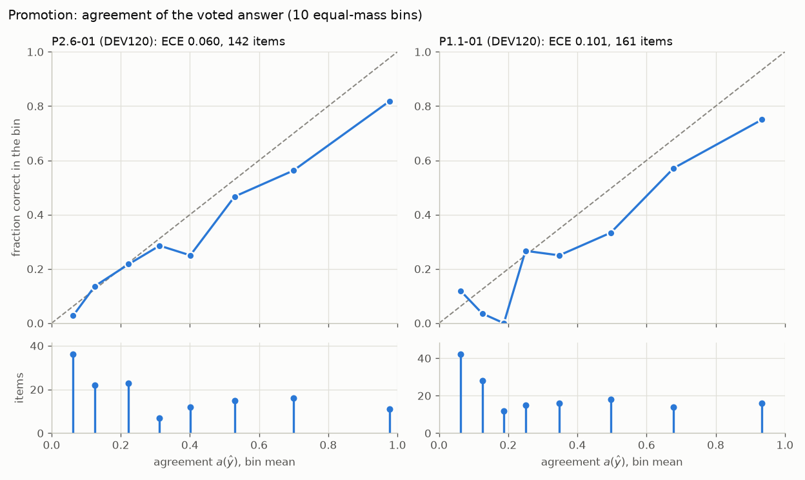
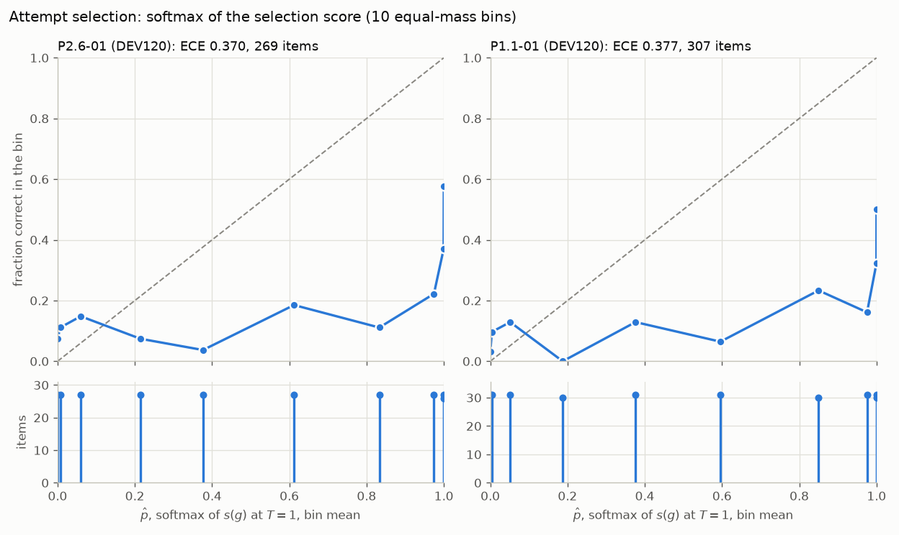
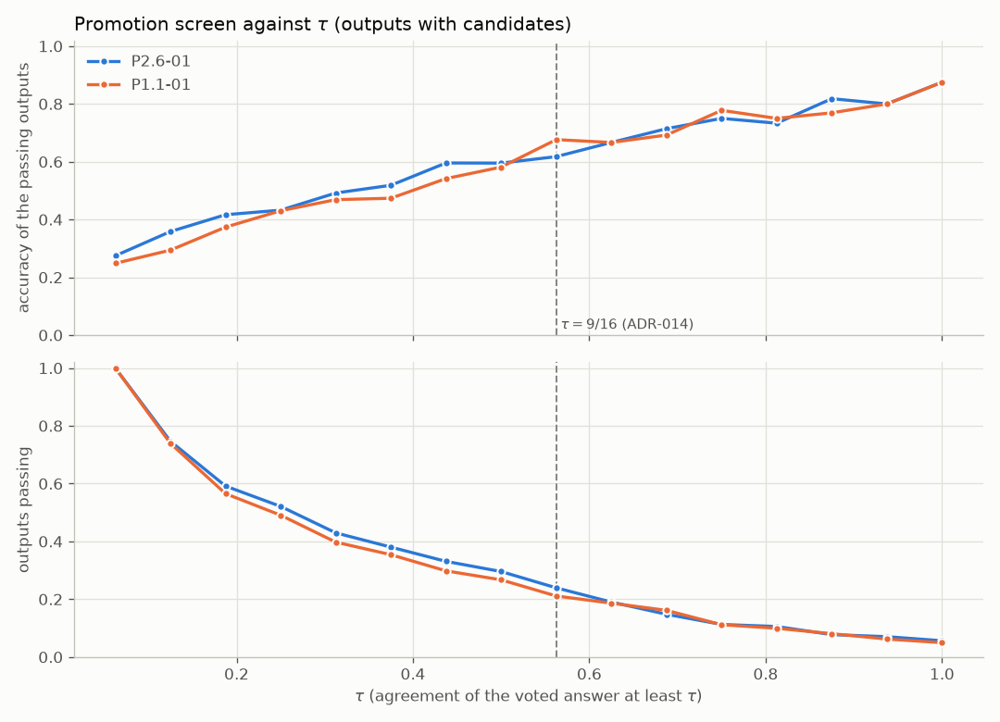

# P2.8: calibration of the free confidence signal, the oracle gap, re-ranking

Generated by `scripts/calibration_report.py` from the pulled logs; no solution file read (an output's correct grid is a candidate its run marked `ALL_CORRECT`), no grid written. Command, from the repository root:

```bash
python scripts/calibration_report.py --out reports/P2.8 --run P2.6-01=~/wt-P2.6/runs/P2.6-01 --run P1.1-01=~/wt-P1.1-timing/runs/P1.1-01 --run P1.3-01/r256-proj-emb=~/wt-P1.3/runs/P1.3-01/run_logs/r256-proj-emb --run P1.3-01/r16-attn=~/wt-P1.3/runs/P1.3-01/run_logs/r16-attn --run P1.3-01/r32-attn=~/wt-P1.3/runs/P1.3-01/run_logs/r32-attn --run P1.3-01/r16-proj=~/wt-P1.3/runs/P1.3-01/run_logs/r16-proj --run P1.3-01/r64-proj=~/wt-P1.3/runs/P1.3-01/run_logs/r64-proj --run P2.1-01=~/wt-P2.1/runs/P2.1-01/run_logs/r256-proj-emb-holdout --run P2.1-02=~/wt-P2.1/runs/P2.1-02/run_logs/r256-proj-emb-holdout-intest --run P2.1-03=~/wt-P2.1/runs/P2.1-03/run_logs/r256-proj-emb --run P2.5-01=~/wt-P2.5/runs/P2.5-01/run_logs/r16-attn-in-context --run P2.5-02=~/wt-P2.5/runs/P2.5-02/run_logs/r16-attn-gradient
```

## Reproduction

From `candidates.json` alone: the distinct grids per test output, their `score_kgmon` values (the moved `score_sum` and `getter_kgmon` through `arc26.loop.tally`, each value recomputed from its definition to $10^{-9}$), the two attempts (padded with `[[0]]` as `get_submission` does), and their score (`arc26.evaluate`). Every run below reproduces exactly: every output's attempts equal `submission.json`, the solved outputs equal the logged `score_kgmon` set, and the score equals the `Reload score` line.

| Run | Subset | Outputs (with candidates) | View candidates | Distinct grids | Attempts equal | Score (tasks) | `Reload score` |
|---|---|---|---|---|---|---|---|
| P2.6-01 | DEV120, 120 tasks | 172 (142) | 2058 | 1015 | 172 of 172 | 38.33 | 38.3333 |
| P1.1-01 | DEV120, 120 tasks | 172 (161) | 2335 | 1181 | 172 of 172 | 37.17 | 37.1667 |
| P1.3-01/r256-proj-emb | DEV40, 40 tasks | 55 (51) | 662 | 348 | 55 of 55 | 8.50 | 8.5000 |
| P1.3-01/r16-attn | DEV40, 40 tasks | 55 (44) | 552 | 304 | 55 of 55 | 10.50 | 10.5000 |
| P1.3-01/r32-attn | DEV40, 40 tasks | 55 (46) | 567 | 295 | 55 of 55 | 10.00 | 10.0000 |
| P1.3-01/r16-proj | DEV40, 40 tasks | 55 (49) | 630 | 328 | 55 of 55 | 10.00 | 10.0000 |
| P1.3-01/r64-proj | DEV40, 40 tasks | 55 (49) | 637 | 325 | 55 of 55 | 8.00 | 8.0000 |
| P2.1-01 | DEV40, 40 tasks | 55 (49) | 638 | 337 | 55 of 55 | 5.00 | 5.0000 |
| P2.1-02 | DEV40, 40 tasks | 55 (41) | 572 | 271 | 55 of 55 | 7.00 | 7.0000 |
| P2.1-03 | DEV40, 40 tasks | 55 (52) | 636 | 327 | 55 of 55 | 6.50 | 6.5000 |
| P2.5-01 | DEV40, 40 tasks | 55 (49) | 546 | 282 | 55 of 55 | 8.00 | 8.0000 |
| P2.5-02 | DEV40, 40 tasks | 55 (47) | 530 | 273 | 55 of 55 | 7.00 | 7.0000 |

## Definitions

- **Agreement** $a(g) = |C_g| / 16$: the view candidates equal to $g$ over the 16 decoding views, the quantity `arc26.loop.promote` compares with $\tau$ (`Tally.agreement`, `DECODE_VIEWS`; ADR-014). A view's beams count once each; no view of any run here parsed two beams into one grid (P2.6-01 0, P1.1-01 0, P1.3-01/r256-proj-emb 0, P1.3-01/r16-attn 0, P1.3-01/r32-attn 0, P1.3-01/r16-proj 0, P1.3-01/r64-proj 0, P2.1-01 0, P2.1-02 0, P2.1-03 0, P2.5-01 0, P2.5-02 0 such candidates), so beams and views give the same count.
- **Selection score** $s(g) = |C_g| - \frac{1}{|C_g|} \sum_{c \in C_g} \bar s(c)$, `score_kgmon`'s value ($\bar s(c)$: the mean of $c$'s 8 rescoring NLLs). $\hat p(g) = e^{s(g)/T} / \sum_{g'} e^{s(g')/T}$ over the output's distinct grids, $T = 1$ fixed, nothing fit.
- **Beam score**: the mean `beam_score` (NLL under the candidate's own view) over $C_g$.
- **Promotion decision**: per output with candidates, the voted answer $\hat y$ (`score_kgmon`'s first grid, the one `promote` checks) with $\hat p = a(\hat y)$. Secondary rows: the grid with the most view candidates instead (it differs from $\hat y$ on P2.6-01 25, P1.1-01 24 outputs), and $\hat y$ over the views actually decoded instead of 16 (the 1200 s cap cut P2.6-01 5, P1.1-01 11 outputs short).
- **Attempt selection**: the two attempts per output with candidates (one when the output has one grid), $\hat p(g)$ each.
- **Metrics**: 10 equal-mass bins (a bin boundary never splits equal $\hat p$, so fewer bins can result), ECE $= \sum_b \frac{n_b}{N} |\bar c_b - \bar p_b|$, Brier $= \frac{1}{N} \sum_i (\hat p_i - c_i)^2$, AUROC (ties count half). Brier and AUROC intervals: 95% percentile bootstrap over tasks, 2000 resamples, `random.Random(0)`; "undefined": resamples with one class only, where AUROC has no value.
- **ECE against perfect calibration**: binned ECE is biased upward, so the resampled ECEs sit above the point estimate and their 2.5th to 97.5th percentiles ("resampled range") are not a confidence interval. The reference is the ECE a perfectly calibrated predictor would show with the same $\hat p$ values and bins: each item correct with probability $\hat p_i$, independently, 2000 draws, `random.Random(0)`; its mean, its 95th percentile, and the share of draws at or above the observed ECE. An observed ECE under the 95th percentile cannot be told apart from perfect calibration.

## Calibration

| Run | Subset | Decision | Items | Mean $\hat p$ | Correct | ECE | ECE resampled range | ECE if calibrated: mean (95th pct) | Calibrated draws at or above | Brier [95%] | AUROC [95%] |
|---|---|---|---|---|---|---|---|---|---|---|---|
| P2.6-01 | DEV120 | promotion, $\hat y$ | 142 (107 tasks) | 0.331 | 0.275 | 0.060 | 0.056 to 0.154 | 0.069 (0.102) | 0.68 | 0.151 [0.117, 0.188] | 0.819 [0.742, 0.887] |
| P2.6-01 | DEV120 | promotion, most view candidates | 142 (107 tasks) | 0.344 | 0.268 | 0.082 | 0.063 to 0.158 | 0.076 (0.109) | 0.37 | 0.145 [0.113, 0.179] | 0.838 [0.769, 0.906] |
| P2.6-01 | DEV120 | promotion, $\hat y$ over decoded views | 142 (107 tasks) | 0.338 | 0.275 | 0.066 | 0.060 to 0.159 | 0.069 (0.101) | 0.53 | 0.152 [0.118, 0.190] | 0.817 [0.741, 0.887] |
| P2.6-01 | DEV120 | attempt selection | 269 (107 tasks) | 0.506 | 0.190 | 0.370 | 0.320 to 0.413 | 0.034 (0.054) | 0.00 | 0.333 [0.291, 0.378] | 0.720 [0.624, 0.807] |
| P1.1-01 | DEV120 | promotion, $\hat y$ | 161 (118 tasks) | 0.317 | 0.248 | 0.101 | 0.073 to 0.171 | 0.066 (0.097) | 0.03 | 0.146 [0.110, 0.185] | 0.791 [0.683, 0.889] |
| P1.1-01 | DEV120 | promotion, most view candidates | 161 (118 tasks) | 0.328 | 0.217 | 0.113 | 0.083 to 0.169 | 0.067 (0.098) | 0.01 | 0.125 [0.095, 0.156] | 0.864 [0.786, 0.930] |
| P1.1-01 | DEV120 | promotion, $\hat y$ over decoded views | 161 (118 tasks) | 0.329 | 0.248 | 0.124 | 0.081 to 0.181 | 0.065 (0.095) | 0.00 | 0.149 [0.112, 0.188] | 0.790 [0.681, 0.887] |
| P1.1-01 | DEV120 | attempt selection | 307 (118 tasks) | 0.502 | 0.166 | 0.377 | 0.335 to 0.414 | 0.031 (0.050) | 0.00 | 0.330 [0.297, 0.367] | 0.742 [0.661, 0.814] |
| P1.3-01/r256-proj-emb | DEV40 | promotion, $\hat y$ | 51 (40 tasks) | 0.301 | 0.137 | 0.201 | 0.138 to 0.339 | 0.095 (0.145) | 0.00 | 0.185 [0.111, 0.279] | 0.643 [0.356, 0.898] |
| P1.3-01/r256-proj-emb | DEV40 | promotion, most view candidates | 51 (40 tasks) | 0.312 | 0.118 | 0.224 | 0.154 to 0.339 | 0.108 (0.156) | 0.00 | 0.171 [0.102, 0.260] | 0.709 [0.407, 0.955; 4 undefined] |
| P1.3-01/r256-proj-emb | DEV40 | attempt selection | 99 (40 tasks) | 0.493 | 0.091 | 0.422 | 0.368 to 0.482 | 0.058 (0.091) | 0.00 | 0.362 [0.306, 0.418] | 0.728 [0.483, 0.924] |
| P1.3-01/r16-attn | DEV40 | promotion, $\hat y$ | 44 (36 tasks) | 0.280 | 0.159 | 0.132 | 0.092 to 0.276 | 0.105 (0.158) | 0.18 | 0.143 [0.073, 0.228] | 0.822 [0.646, 0.964; 1 undefined] |
| P1.3-01/r16-attn | DEV40 | promotion, most view candidates | 44 (36 tasks) | 0.294 | 0.114 | 0.180 | 0.126 to 0.288 | 0.110 (0.166) | 0.02 | 0.116 [0.057, 0.191] | 0.918 [0.800, 0.995; 9 undefined] |
| P1.3-01/r16-attn | DEV40 | attempt selection | 81 (36 tasks) | 0.514 | 0.136 | 0.427 | 0.356 to 0.507 | 0.061 (0.094) | 0.00 | 0.384 [0.311, 0.461] | 0.622 [0.394, 0.829] |
| P1.3-01/r32-attn | DEV40 | promotion, $\hat y$ | 46 (36 tasks) | 0.298 | 0.152 | 0.145 | 0.102 to 0.284 | 0.096 (0.145) | 0.05 | 0.127 [0.061, 0.206] | 0.897 [0.776, 0.981; 1 undefined] |
| P1.3-01/r32-attn | DEV40 | promotion, most view candidates | 46 (36 tasks) | 0.307 | 0.152 | 0.155 | 0.115 to 0.293 | 0.100 (0.149) | 0.05 | 0.129 [0.063, 0.209] | 0.897 [0.776, 0.981; 1 undefined] |
| P1.3-01/r32-attn | DEV40 | attempt selection | 84 (36 tasks) | 0.523 | 0.119 | 0.428 | 0.361 to 0.500 | 0.063 (0.100) | 0.00 | 0.371 [0.309, 0.437] | 0.702 [0.476, 0.881] |
| P1.3-01/r16-proj | DEV40 | promotion, $\hat y$ | 49 (37 tasks) | 0.304 | 0.163 | 0.140 | 0.099 to 0.265 | 0.105 (0.156) | 0.12 | 0.138 [0.074, 0.212] | 0.828 [0.659, 0.959] |
| P1.3-01/r16-proj | DEV40 | promotion, most view candidates | 49 (37 tasks) | 0.310 | 0.163 | 0.147 | 0.101 to 0.267 | 0.110 (0.159) | 0.11 | 0.140 [0.077, 0.213] | 0.820 [0.640, 0.959] |
| P1.3-01/r16-proj | DEV40 | attempt selection | 94 (37 tasks) | 0.508 | 0.106 | 0.423 | 0.356 to 0.483 | 0.055 (0.084) | 0.00 | 0.368 [0.306, 0.423] | 0.758 [0.543, 0.933] |
| P1.3-01/r64-proj | DEV40 | promotion, $\hat y$ | 49 (38 tasks) | 0.300 | 0.082 | 0.218 | 0.145 to 0.312 | 0.103 (0.154) | 0.00 | 0.129 [0.068, 0.201] | 0.925 [0.786, 1.000; 25 undefined] |
| P1.3-01/r64-proj | DEV40 | promotion, most view candidates | 49 (38 tasks) | 0.311 | 0.082 | 0.230 | 0.158 to 0.326 | 0.115 (0.168) | 0.00 | 0.132 [0.071, 0.205] | 0.925 [0.786, 1.000; 25 undefined] |
| P1.3-01/r64-proj | DEV40 | attempt selection | 93 (38 tasks) | 0.511 | 0.086 | 0.471 | 0.427 to 0.533 | 0.061 (0.094) | 0.00 | 0.413 [0.354, 0.472] | 0.578 [0.278, 0.867] |
| P2.1-01 | DEV40 | promotion, $\hat y$ | 49 (38 tasks) | 0.282 | 0.061 | 0.221 | 0.148 to 0.331 | 0.110 (0.165) | 0.00 | 0.148 [0.076, 0.227] | 0.812 [0.604, 1.000; 101 undefined] |
| P2.1-01 | DEV40 | promotion, most view candidates | 49 (38 tasks) | 0.297 | 0.061 | 0.236 | 0.159 to 0.342 | 0.115 (0.170) | 0.00 | 0.152 [0.080, 0.231] | 0.801 [0.582, 1.000; 101 undefined] |
| P2.1-01 | DEV40 | attempt selection | 93 (38 tasks) | 0.508 | 0.054 | 0.492 | 0.442 to 0.538 | 0.066 (0.098) | 0.00 | 0.407 [0.352, 0.466] | 0.516 [0.121, 0.874; 11 undefined] |
| P2.1-02 | DEV40 | promotion, $\hat y$ | 41 (33 tasks) | 0.323 | 0.122 | 0.201 | 0.140 to 0.363 | 0.122 (0.177) | 0.01 | 0.191 [0.101, 0.295] | 0.714 [0.466, 0.924; 7 undefined] |
| P2.1-02 | DEV40 | promotion, most view candidates | 41 (33 tasks) | 0.335 | 0.098 | 0.238 | 0.168 to 0.372 | 0.126 (0.186) | 0.00 | 0.176 [0.093, 0.279] | 0.797 [0.568, 0.986; 21 undefined] |
| P2.1-02 | DEV40 | attempt selection | 79 (33 tasks) | 0.501 | 0.089 | 0.450 | 0.383 to 0.510 | 0.067 (0.103) | 0.00 | 0.376 [0.308, 0.442] | 0.639 [0.353, 0.878; 2 undefined] |
| P2.1-03 | DEV40 | promotion, $\hat y$ | 52 (40 tasks) | 0.293 | 0.115 | 0.212 | 0.139 to 0.319 | 0.099 (0.147) | 0.00 | 0.154 [0.086, 0.235] | 0.685 [0.346, 0.971; 2 undefined] |
| P2.1-03 | DEV40 | promotion, most view candidates | 52 (40 tasks) | 0.305 | 0.096 | 0.216 | 0.154 to 0.323 | 0.104 (0.151) | 0.00 | 0.140 [0.077, 0.218] | 0.779 [0.423, 0.984; 14 undefined] |
| P2.1-03 | DEV40 | attempt selection | 95 (40 tasks) | 0.530 | 0.074 | 0.456 | 0.403 to 0.512 | 0.065 (0.098) | 0.00 | 0.386 [0.330, 0.445] | 0.776 [0.582, 0.936] |
| P2.5-01 | DEV40 | promotion, $\hat y$ | 49 (37 tasks) | 0.267 | 0.102 | 0.165 | 0.111 to 0.268 | 0.106 (0.157) | 0.04 | 0.117 [0.059, 0.185] | 0.882 [0.736, 0.979; 14 undefined] |
| P2.5-01 | DEV40 | promotion, most view candidates | 49 (37 tasks) | 0.274 | 0.102 | 0.172 | 0.118 to 0.270 | 0.107 (0.157) | 0.03 | 0.119 [0.061, 0.187] | 0.880 [0.732, 0.979; 14 undefined] |
| P2.5-01 | DEV40 | attempt selection | 89 (37 tasks) | 0.534 | 0.090 | 0.494 | 0.426 to 0.566 | 0.054 (0.087) | 0.00 | 0.431 [0.355, 0.510] | 0.566 [0.272, 0.842] |
| P2.5-02 | DEV40 | promotion, $\hat y$ | 47 (37 tasks) | 0.263 | 0.106 | 0.157 | 0.104 to 0.259 | 0.105 (0.157) | 0.06 | 0.117 [0.058, 0.184] | 0.883 [0.740, 0.981; 14 undefined] |
| P2.5-02 | DEV40 | promotion, most view candidates | 47 (37 tasks) | 0.277 | 0.106 | 0.170 | 0.119 to 0.272 | 0.110 (0.165) | 0.04 | 0.120 [0.062, 0.187] | 0.879 [0.721, 0.981; 14 undefined] |
| P2.5-02 | DEV40 | attempt selection | 87 (37 tasks) | 0.528 | 0.080 | 0.476 | 0.411 to 0.547 | 0.057 (0.089) | 0.00 | 0.411 [0.337, 0.487] | 0.657 [0.359, 0.908] |

AUROC of each signal over every distinct grid (a ranking measure; the beam score ranks lower NLL higher):

| Run | Distinct grids (correct) | Agreement | Selection score | Beam score |
|---|---|---|---|---|
| P2.6-01 | 1015 (60) | 0.850 | 0.892 | 0.802 |
| P1.1-01 | 1181 (60) | 0.810 | 0.885 | 0.737 |
| P1.3-01/r256-proj-emb | 348 (10) | 0.780 | 0.892 | 0.808 |
| P1.3-01/r16-attn | 304 (12) | 0.848 | 0.934 | 0.785 |
| P1.3-01/r32-attn | 295 (11) | 0.811 | 0.947 | 0.795 |
| P1.3-01/r16-proj | 328 (12) | 0.836 | 0.919 | 0.839 |
| P1.3-01/r64-proj | 325 (11) | 0.825 | 0.917 | 0.705 |
| P2.1-01 | 337 (5) | 0.925 | 0.952 | 0.773 |
| P2.1-02 | 271 (7) | 0.907 | 0.937 | 0.679 |
| P2.1-03 | 327 (8) | 0.745 | 0.918 | 0.799 |
| P2.5-01 | 282 (8) | 0.891 | 0.937 | 0.758 |
| P2.5-02 | 273 (7) | 0.968 | 0.968 | 0.797 |

### Reliability diagrams




P2.6-01, promotion, $\hat y$:

| Bin | Items | $\hat p$ range | Mean $\hat p$ | Fraction correct |
|---|---|---|---|---|
| 1 | 36 | 0.062 to 0.062 | 0.062 | 0.028 |
| 2 | 22 | 0.125 to 0.125 | 0.125 | 0.136 |
| 3 | 23 | 0.188 to 0.250 | 0.223 | 0.217 |
| 4 | 7 | 0.312 to 0.312 | 0.312 | 0.286 |
| 5 | 12 | 0.375 to 0.438 | 0.401 | 0.250 |
| 6 | 15 | 0.500 to 0.562 | 0.529 | 0.467 |
| 7 | 16 | 0.625 to 0.812 | 0.699 | 0.562 |
| 8 | 11 | 0.875 to 1.000 | 0.977 | 0.818 |

P2.6-01, attempt selection:

| Bin | Items | $\hat p$ range | Mean $\hat p$ | Fraction correct |
|---|---|---|---|---|
| 1 | 27 | 0.000 to 0.000 | 0.000 | 0.074 |
| 2 | 27 | 0.000 to 0.020 | 0.007 | 0.111 |
| 3 | 27 | 0.022 to 0.122 | 0.060 | 0.148 |
| 4 | 27 | 0.136 to 0.293 | 0.215 | 0.074 |
| 5 | 27 | 0.294 to 0.460 | 0.376 | 0.037 |
| 6 | 27 | 0.465 to 0.700 | 0.612 | 0.185 |
| 7 | 27 | 0.708 to 0.941 | 0.833 | 0.111 |
| 8 | 27 | 0.949 to 0.997 | 0.974 | 0.222 |
| 9 | 27 | 0.998 to 1.000 | 1.000 | 0.370 |
| 10 | 26 | 1.000 to 1.000 | 1.000 | 0.577 |

P1.1-01, promotion, $\hat y$:

| Bin | Items | $\hat p$ range | Mean $\hat p$ | Fraction correct |
|---|---|---|---|---|
| 1 | 42 | 0.062 to 0.062 | 0.062 | 0.119 |
| 2 | 28 | 0.125 to 0.125 | 0.125 | 0.036 |
| 3 | 12 | 0.188 to 0.188 | 0.188 | 0.000 |
| 4 | 15 | 0.250 to 0.250 | 0.250 | 0.267 |
| 5 | 16 | 0.312 to 0.375 | 0.348 | 0.250 |
| 6 | 18 | 0.438 to 0.562 | 0.497 | 0.333 |
| 7 | 14 | 0.625 to 0.750 | 0.679 | 0.571 |
| 8 | 16 | 0.812 to 1.000 | 0.934 | 0.750 |

P1.1-01, attempt selection:

| Bin | Items | $\hat p$ range | Mean $\hat p$ | Fraction correct |
|---|---|---|---|---|
| 1 | 31 | 0.000 to 0.000 | 0.000 | 0.032 |
| 2 | 31 | 0.000 to 0.023 | 0.004 | 0.097 |
| 3 | 31 | 0.023 to 0.097 | 0.051 | 0.129 |
| 4 | 30 | 0.100 to 0.261 | 0.188 | 0.000 |
| 5 | 31 | 0.261 to 0.472 | 0.376 | 0.129 |
| 6 | 31 | 0.478 to 0.746 | 0.596 | 0.065 |
| 7 | 30 | 0.749 to 0.939 | 0.850 | 0.233 |
| 8 | 31 | 0.943 to 0.999 | 0.976 | 0.161 |
| 9 | 31 | 0.999 to 1.000 | 1.000 | 0.323 |
| 10 | 30 | 1.000 to 1.000 | 1.000 | 0.500 |

### Coverage and accuracy of the promotion screen against $\tau$

Outputs with candidates whose voted answer reaches $a(\hat y) \ge \tau = k/16$ (what the loop's agreement screen would have passed before the re-decode and the gate), and how many of them are correct.



| $\tau$ | P2.6-01 passing | P2.6-01 correct | P1.1-01 passing | P1.1-01 correct |
|---|---|---|---|---|
| 1/16 | 142 of 142 (1.000) | 39 (0.275) | 161 of 161 (1.000) | 40 (0.248) |
| 2/16 | 106 of 142 (0.746) | 38 (0.358) | 119 of 161 (0.739) | 35 (0.294) |
| 3/16 | 84 of 142 (0.592) | 35 (0.417) | 91 of 161 (0.565) | 34 (0.374) |
| 4/16 | 74 of 142 (0.521) | 32 (0.432) | 79 of 161 (0.491) | 34 (0.430) |
| 5/16 | 61 of 142 (0.430) | 30 (0.492) | 64 of 161 (0.398) | 30 (0.469) |
| 6/16 | 54 of 142 (0.380) | 28 (0.519) | 57 of 161 (0.354) | 27 (0.474) |
| 7/16 | 47 of 142 (0.331) | 28 (0.596) | 48 of 161 (0.298) | 26 (0.542) |
| 8/16 | 42 of 142 (0.296) | 25 (0.595) | 43 of 161 (0.267) | 25 (0.581) |
| 9/16 | 34 of 142 (0.239) | 21 (0.618) | 34 of 161 (0.211) | 23 (0.676) |
| 10/16 | 27 of 142 (0.190) | 18 (0.667) | 30 of 161 (0.186) | 20 (0.667) |
| 11/16 | 21 of 142 (0.148) | 15 (0.714) | 26 of 161 (0.161) | 18 (0.692) |
| 12/16 | 16 of 142 (0.113) | 12 (0.750) | 18 of 161 (0.112) | 14 (0.778) |
| 13/16 | 15 of 142 (0.106) | 11 (0.733) | 16 of 161 (0.099) | 12 (0.750) |
| 14/16 | 11 of 142 (0.077) | 9 (0.818) | 13 of 161 (0.081) | 10 (0.769) |
| 15/16 | 10 of 142 (0.070) | 8 (0.800) | 10 of 161 (0.062) | 8 (0.800) |
| 16/16 | 8 of 142 (0.056) | 7 (0.875) | 8 of 161 (0.050) | 7 (0.875) |

## Oracle gap

Outputs with a correct candidate and no correct attempt, each weighted $1/n$ for a task with $n$ test outputs; points are 100 over the subset's tasks. Split by the correct grid's place under `score_kgmon` (3rd to 5th, lower); "one view": the correct grid came from a single view (a cut across the two).

| Run | Subset | Score | Oracle | Gap (tasks) | Gap (points) | Outputs | Ranked 3rd to 5th | Lower | One view |
|---|---|---|---|---|---|---|---|---|---|
| P2.6-01 | DEV120, 120 tasks | 38.33 | 44.50 | 6.17 | 5.14 | 9 | 3.67 | 2.50 | 4.83 |
| P1.1-01 | DEV120, 120 tasks | 37.17 | 44.00 | 6.83 | 5.69 | 9 | 3.33 | 3.50 | 3.50 |
| P1.3-01/r256-proj-emb | DEV40, 40 tasks | 8.50 | 9.50 | 1.00 | 2.50 | 1 | 1.00 | 0.00 | 1.00 |
| P1.3-01/r16-attn | DEV40, 40 tasks | 10.50 | 11.50 | 1.00 | 2.50 | 1 | 0.00 | 1.00 | 1.00 |
| P1.3-01/r32-attn | DEV40, 40 tasks | 10.00 | 11.00 | 1.00 | 2.50 | 1 | 1.00 | 0.00 | 1.00 |
| P1.3-01/r16-proj | DEV40, 40 tasks | 10.00 | 12.00 | 2.00 | 5.00 | 2 | 2.00 | 0.00 | 2.00 |
| P1.3-01/r64-proj | DEV40, 40 tasks | 8.00 | 11.00 | 3.00 | 7.50 | 3 | 3.00 | 0.00 | 2.00 |
| P2.1-01 | DEV40, 40 tasks | 5.00 | 5.00 | 0.00 | 0.00 | 0 | 0.00 | 0.00 | 0.00 |
| P2.1-02 | DEV40, 40 tasks | 7.00 | 7.00 | 0.00 | 0.00 | 0 | 0.00 | 0.00 | 0.00 |
| P2.1-03 | DEV40, 40 tasks | 6.50 | 7.50 | 1.00 | 2.50 | 1 | 1.00 | 0.00 | 1.00 |
| P2.5-01 | DEV40, 40 tasks | 8.00 | 8.00 | 0.00 | 0.00 | 0 | 0.00 | 0.00 | 0.00 |
| P2.5-02 | DEV40, 40 tasks | 7.00 | 7.00 | 0.00 | 0.00 | 0 | 0.00 | 0.00 | 0.00 |

P2.6-01: the gap's outputs (rank and signals of the correct grid; the voted answer's agreement for comparison).

| Output | Weight | Rank | Distinct grids | Views | $a$ | $s$ | $\hat p$ | $a(\hat y)$ |
|---|---|---|---|---|---|---|---|---|
| `142ca369_0` | 0.50 | 9 | 17 | 1 | 0.0625 | -22.468 | 0.000 | 0.0625 |
| `1ae2feb7_1` | 0.33 | 5 | 7 | 1 | 0.0625 | -6.460 | 0.000 | 0.8125 |
| `28a6681f_0` | 1.00 | 6 | 19 | 1 | 0.0625 | -7.096 | 0.061 | 0.0625 |
| `3dc255db_0` | 1.00 | 6 | 19 | 1 | 0.0625 | -13.554 | 0.000 | 0.1250 |
| `62593bfd_1` | 0.50 | 4 | 10 | 1 | 0.0625 | -2.387 | 0.083 | 0.1875 |
| `78332cb0_1` | 0.50 | 4 | 9 | 1 | 0.0625 | -6.162 | 0.013 | 0.3125 |
| `a6f40cea_0` | 1.00 | 3 | 12 | 2 | 0.1250 | -7.080 | 0.129 | 0.1250 |
| `b6f77b65_0` | 0.33 | 4 | 5 | 4 | 0.2500 | -6.158 | 0.000 | 0.5000 |
| `b9e38dc0_0` | 1.00 | 3 | 6 | 1 | 0.0625 | -8.255 | 0.007 | 0.2500 |

P1.1-01: the gap's outputs (rank and signals of the correct grid; the voted answer's agreement for comparison).

| Output | Weight | Rank | Distinct grids | Views | $a$ | $s$ | $\hat p$ | $a(\hat y)$ |
|---|---|---|---|---|---|---|---|---|
| `142ca369_0` | 0.50 | 5 | 8 | 3 | 0.1875 | -14.320 | 0.000 | 0.2500 |
| `3dc255db_0` | 1.00 | 8 | 11 | 1 | 0.0625 | -10.420 | 0.000 | 0.1250 |
| `4c7dc4dd_1` | 0.50 | 6 | 9 | 1 | 0.0625 | -8.453 | 0.000 | 0.2500 |
| `58490d8a_0` | 1.00 | 8 | 10 | 1 | 0.0625 | -12.251 | 0.000 | 0.4375 |
| `78332cb0_0` | 0.50 | 4 | 11 | 2 | 0.1250 | -5.647 | 0.002 | 0.3750 |
| `8f215267_0` | 1.00 | 7 | 13 | 2 | 0.1250 | -7.085 | 0.004 | 0.2500 |
| `b6f77b65_0` | 0.33 | 5 | 8 | 3 | 0.1875 | -8.614 | 0.000 | 0.3750 |
| `dfadab01_0` | 1.00 | 3 | 5 | 2 | 0.1250 | -7.435 | 0.000 | 0.4375 |
| `eee78d87_0` | 1.00 | 3 | 3 | 1 | 0.0625 | -7.292 | 0.000 | 0.6250 |

## Re-ranking (report only)

Fixed rules over each output's distinct grids, the first two as the attempts; ties keep `score_kgmon`'s order. Nothing in `arc26/decode.py` or any protected path changes.

- `kgmon`: `score_kgmon`, the notebook's selection (the baseline).
- `agreement`: agreement first: $|C_g|$ descending, ties in `score_kgmon` order.
- `kgmon-agreement`: selection score first, agreement as tie break: $(s(g), |C_g|)$ descending.
- `product`: the product $a(g) \hat p(g)$ of the two decisions' confidences.

`kgmon-agreement` can differ from `score_kgmon` only where two grids tie in $s(g)$: P2.6-01 0, P1.1-01 0, P1.3-01/r256-proj-emb 0, P1.3-01/r16-attn 0, P1.3-01/r32-attn 0, P1.3-01/r16-proj 0, P1.3-01/r64-proj 0, P2.1-01 0, P2.1-02 0, P2.1-03 0, P2.5-01 0, P2.5-02 0 such outputs.

Net gain in tasks over `score_kgmon` on each run (in sample), with the gross credit recovered (outputs the rule solves and `score_kgmon` does not, $1/n$ each) and lost; "identical": the rule submits `score_kgmon`'s two grids for every output:

| Run | Subset | `score_kgmon` | Gap | `agreement` | `kgmon-agreement` | `product` |
|---|---|---|---|---|---|---|
| P2.6-01 | DEV120 | 38.33 | 6.17 | -0.67 (recovered 0.33, lost 1.00) | identical to `kgmon` | -1.00 (recovered 0.00, lost 1.00) |
| P1.1-01 | DEV120 | 37.17 | 6.83 | -5.83 (recovered 0.33, lost 6.17) | identical to `kgmon` | 0 (recovered 0.00, lost 0.00) |
| P1.3-01/r256-proj-emb | DEV40 | 8.50 | 1.00 | -1.00 (recovered 0.00, lost 1.00) | identical to `kgmon` | -1.00 (recovered 0.00, lost 1.00) |
| P1.3-01/r16-attn | DEV40 | 10.50 | 1.00 | -0.50 (recovered 0.00, lost 0.50) | identical to `kgmon` | 0 (recovered 0.00, lost 0.00) |
| P1.3-01/r32-attn | DEV40 | 10.00 | 1.00 | -2.00 (recovered 0.00, lost 2.00) | identical to `kgmon` | -1.00 (recovered 0.00, lost 1.00) |
| P1.3-01/r16-proj | DEV40 | 10.00 | 2.00 | -1.00 (recovered 0.00, lost 1.00) | identical to `kgmon` | 0 (recovered 0.00, lost 0.00) |
| P1.3-01/r64-proj | DEV40 | 8.00 | 3.00 | -1.00 (recovered 0.00, lost 1.00) | identical to `kgmon` | 0 (recovered 0.00, lost 0.00) |
| P2.1-01 | DEV40 | 5.00 | 0.00 | 0 (recovered 0.00, lost 0.00) | identical to `kgmon` | 0 (recovered 0.00, lost 0.00) |
| P2.1-02 | DEV40 | 7.00 | 0.00 | 0 (recovered 0.00, lost 0.00) | identical to `kgmon` | 0 (recovered 0.00, lost 0.00) |
| P2.1-03 | DEV40 | 6.50 | 1.00 | -0.50 (recovered 0.00, lost 0.50) | identical to `kgmon` | 0 (recovered 0.00, lost 0.00) |
| P2.5-01 | DEV40 | 8.00 | 0.00 | -1.00 (recovered 0.00, lost 1.00) | identical to `kgmon` | identical to `kgmon` |
| P2.5-02 | DEV40 | 7.00 | 0.00 | 0 (recovered 0.00, lost 0.00) | identical to `kgmon` | 0 (recovered 0.00, lost 0.00) |

Held out: on each DEV120 run the alternative rule with the largest net gain is chosen (the earlier one above on a tie, even when none gains), leaving out a rule identical to `score_kgmon` on that run, and scored on the other run; the DEV40 runs are extra rows.

| Scored on | Subset | Gap | chosen on P2.6-01: `agreement` | chosen on P1.1-01: `product` |
|---|---|---|---|---|
| P2.6-01 | DEV120 | 6.17 | -0.67 (recovered 0.33, lost 1.00) in sample | -1.00 (recovered 0.00, lost 1.00) |
| P1.1-01 | DEV120 | 6.83 | -5.83 (recovered 0.33, lost 6.17) | 0 (recovered 0.00, lost 0.00) in sample |
| P1.3-01/r256-proj-emb | DEV40 | 1.00 | -1.00 (recovered 0.00, lost 1.00) | -1.00 (recovered 0.00, lost 1.00) |
| P1.3-01/r16-attn | DEV40 | 1.00 | -0.50 (recovered 0.00, lost 0.50) | 0 (recovered 0.00, lost 0.00) |
| P1.3-01/r32-attn | DEV40 | 1.00 | -2.00 (recovered 0.00, lost 2.00) | -1.00 (recovered 0.00, lost 1.00) |
| P1.3-01/r16-proj | DEV40 | 2.00 | -1.00 (recovered 0.00, lost 1.00) | 0 (recovered 0.00, lost 0.00) |
| P1.3-01/r64-proj | DEV40 | 3.00 | -1.00 (recovered 0.00, lost 1.00) | 0 (recovered 0.00, lost 0.00) |
| P2.1-01 | DEV40 | 0.00 | 0 (recovered 0.00, lost 0.00) | 0 (recovered 0.00, lost 0.00) |
| P2.1-02 | DEV40 | 0.00 | 0 (recovered 0.00, lost 0.00) | 0 (recovered 0.00, lost 0.00) |
| P2.1-03 | DEV40 | 1.00 | -0.50 (recovered 0.00, lost 0.50) | 0 (recovered 0.00, lost 0.00) |
| P2.5-01 | DEV40 | 0.00 | -1.00 (recovered 0.00, lost 1.00) | identical to `kgmon` |
| P2.5-02 | DEV40 | 0.00 | 0 (recovered 0.00, lost 0.00) | 0 (recovered 0.00, lost 0.00) |

No rule recovers 2 tasks net in both held-out directions (held out, net: `agreement` chosen on P2.6-01: -5.83 on P1.1-01; `product` chosen on P1.1-01: -1.00 on P2.6-01): no proposal.
